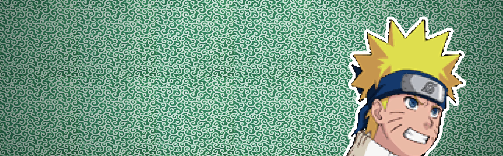
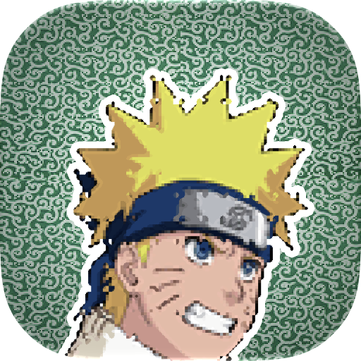
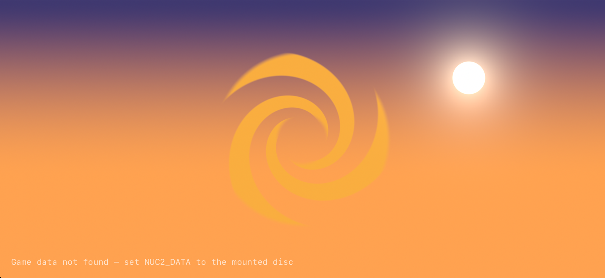
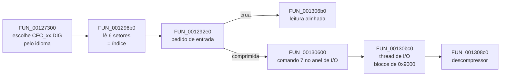
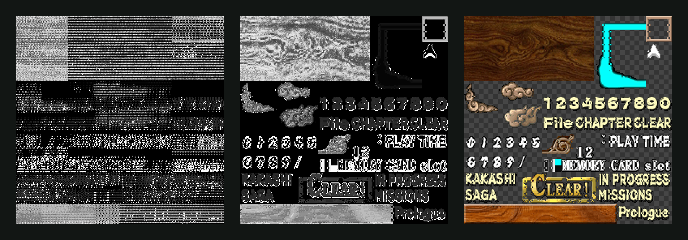
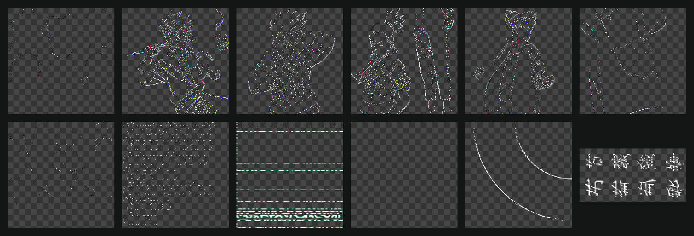
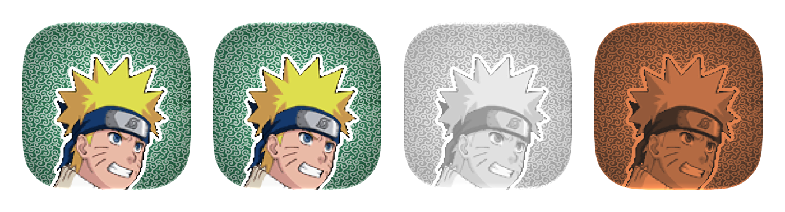

<p align="center">
  
</p>

<h1 align="center">
  <br>
  Naruto: Uzumaki Chronicles 2 — Reimplementação nativa para Apple
</h1>

<p align="center">
  
  
  
  
</p>

<p align="center">
  O <i>Naruto: Uzumaki Chronicles 2</i> de PlayStation 2 (PAL, SLES-55090), estudado com
  <a href="https://github.com/morluto/rea">REA</a> direto no executável do Emotion Engine e reescrito do zero em
  <b>Swift</b> e <b>Metal</b>: <b>4K</b>, <b>HDR</b> (EDR / HDR10 com modo Dolby Vision no Apple TV), <b>60 Hz</b>,
  <b>somente paisagem</b> e <b>tela cheia sem bordas</b>. Os dados vêm do disco do próprio usuário: nada do jogo é
  distribuído aqui.
</p>

---

## 🍥 Estado atual

Projeto em andamento. O que já existe e foi verificado:

| Parte | Estado |
| --- | --- |
| **Arquivo `CFC*.DIG`** | Índice, compressor próprio e tabela de sub-arquivos decifrados. As **688 entradas dos 10 idiomas** expandem sem nenhuma falha (≈2 s por arquivo, 397 MiB cada). |
| **Texturas** | Formato das texturas de UI/sprites decifrado, com emulação do *swizzle* da memória do GS: **3651 texturas** extraídas do disco inglês. |
| **Áudio** | Leitor dos contêineres CRI `AFS` (as faixas ADX ainda não são decodificadas). |
| **App** | Compila para iOS, iPadOS, macOS e tvOS. Superfície Metal paisagem, de ponta a ponta, a 60 Hz com saída HDR. Na primeira abertura pede o `.iso` do usuário (app Arquivos no iPhone/iPad, Finder no Mac), lê o disco direto da imagem ISO 9660 sem copiar, confere que é o SLES-55090 e mostra os retratos decodificados no aparelho. No Apple TV a importação ainda não existe. |
| **Ainda não** | Modelos 3D, animações, fases, scripts, lógica de jogo, vídeo `MV00.DSI`. |

<p align="center"></p>

<p align="center"><sub>O app no simulador do iPhone 17 Pro: paisagem, preenchendo inclusive a área da Dynamic Island. O sol
passa do branco SDR para testar a saída HDR.</sub></p>

## 🔍 Engenharia reversa com REA

Toda a análise do executável `SLES_550.90` passa pelo [REA](https://github.com/morluto/rea), usando o Ghidra
12.1.4 com a extensão [ghidra-emotionengine-reloaded](https://github.com/chaoticgd/ghidra-emotionengine-reloaded)
como motor.

- **Perfil R5900.** O REA só aceita MIPS32r2 o32. O executável do PS2 é MIPS-III com a variante R5900
  (`e_flags = 0x20924000`, EABI64). [`re/rea-r5900-lane.patch`](re/rea-r5900-lane.patch) adiciona ao REA um perfil
  `elf32-exec-r5900-ps2-ee-v1`, ativado quando a linguagem `r5900:LE:32:default` é escolhida.
- **Sessão persistente.** Cada chamada da CLI reimportava o binário (~90 s). [`re/rea-daemon.mjs`](re/rea-daemon.mjs)
  mantém uma sessão MCP do REA aberta e [`re/q`](re/q) faz consultas instantâneas a ela.

```bash
node re/rea-daemon.mjs re/bin/SLES_550.90
```

```bash
re/q procedure_pseudo_code '{"procedure":"0x1308c0"}'
```

O caminho até o compressor, encontrado com `trace`, `xrefs` e `procedure_pseudo_code`:



As anotações completas, com endereços, estão em [`re/NOTES.md`](re/NOTES.md).

## 📦 O formato `CFC.DIG`

| Campo (16 bytes por entrada) | Tipo |
| --- | --- |
| setor inicial (× 0x800) | `u32` |
| tamanho gravado | `u32` |
| número de sub-arquivos | `u16` |
| comprimido? | `u16` |
| tamanho expandido | `u32` |

O compressor é próprio do jogo: um **LZ com histórico por contexto**. Os códigos têm 9 bits, em ordem LSB, e
cada um consome 1 byte + 1 bit. A posição do bit volta a zero a cada bloco de 0x9000 bytes (0x9000 = 9 × 4096,
então o bloco sempre termina num grupo de 8 códigos).

- **Bit 8 ligado:** literal.
- **Bit 8 desligado:** cópia de `(código & 7) + 1` bytes a partir de `histórico[último byte][(código >> 3) & 31]`.
- Depois de cada código, a posição onde ele começou entra num anel de 32 posições indexado pelo último byte escrito.

A implementação em Swift fica em [`DIGDecompressor.swift`](Packages/UCKit/Sources/UCFormats/DIGDecompressor.swift),
com testes em Swift Testing.

## 🖼️ Texturas: desfazendo o swizzle do GS

<p align="center"></p>

<p align="center"><sub><b>Esquerda:</b> os bytes como estão no disco. <b>Centro:</b> depois de reproduzir o endereçamento da
memória do GS. <b>Direita:</b> com a paleta CSM1 aplicada.</sub></p>

O jogo grava as texturas de 8 bits já no formato de upload do GS: um retângulo **PSMCT32** de w × h que a GPU do
PS2 lê como **PSMT8** de 2w × 2h. [`re/scripts/gs.py`](re/scripts/gs.py) reproduz as tabelas de blocos e colunas
da memória local do GS para desfazer esse embaralhamento. As paletas de 256 cores usam a ordem CSM1 (troca dos
bits 3 e 4 do índice), e o alfa vai até 0x80.

- **Tabela de texturas:** registros de 20 bytes `{imagem, clut, w, h}`.
- **Tabela de uploads:** registros de 16 bytes `{0, offset, w, h, w·h/64}`. O offset é **relativo ao próprio
  registro**.

<p align="center"></p>

<p align="center"><sub>Algumas das 3651 texturas decodificadas: rostos da seleção de personagens, arte dos personagens, os
nomes da tela de versus, os padrões karakusa e sayagata dos menus e os selos de mão.</sub></p>

## 🎨 Ícone

<p align="center"></p>

O ícone usa só arte do jogo. O rosto é o do Naruto no atlas da seleção de personagens (`0039/00`), ampliado com
Scale2x para manter os contornos. O fundo é o padrão karakusa verde dos menus (`0216/00`, o mesmo do cabeçalho
`0014/36`).

- [`re/scripts/MakeIcon.swift`](re/scripts/MakeIcon.swift) monta as camadas.
- **iOS, iPadOS e macOS:** um documento do **Icon Composer** com Liquid Glass.
- **tvOS:** ícone em camadas com parallax e as imagens da Top Shelf.

## 📱 O app

| Requisito | Como |
| --- | --- |
| **Metal 4** | `MTL4CommandQueue`, `MTL4CommandAllocator`, argument tables, residency sets e `MTL4Compiler` no iPhone, iPad e Mac. O SDK do tvOS 27 não tem Metal 4 e o do simulador traz os headers vazios; nos dois casos o app usa o Metal clássico com os mesmos shaders. |
| **HDR** | Cena em `rgba16Float` linear e depois uma transformação de saída. EDR em Display P3 estendido no iPhone, iPad e Mac. PQ BT.2100 (HDR10) no Apple TV, que pede à TV o modo **Dolby Vision 4K 60 Hz** via `AVDisplayManager`. Apps não conseguem gerar Dolby Vision em tempo real, então o tvOS converte o HDR10 para o modo da TV. |
| **4K a 60 Hz** | Drawable na resolução nativa do painel (3840×2160 no Apple TV 4K) e `CAMetalDisplayLink` pedindo 60 Hz. |
| **Ritmo pelo tempo medido** | O jogo avança pelo tempo real, nunca pela taxa anunciada da tela ([`FramePacer`](Packages/UCKit/Sources/UCEngine/FramePacer.swift)). Perto de 60 ou 120 Hz trava no vsync (exatamente 1 tick por quadro, sem tremido de 0/2 ticks) e conta vsyncs perdidos. Em 50, 30 Hz ou taxa variável segue o relógio. Depois de uma parada (troca de modo da TV, troca de app) descarta o atraso em vez de acelerar. Os casos têm testes: ProMotion caindo para 60 Hz, vsync perdido, 50/30 Hz, parada longa. Em Debug, o log `com.byescaleira.nuc2/pacing` mostra fps real, ticks/s, CPU e GPU por quadro. |
| **Cor** | A cena é linear BT.709. A saída converte a gama com matrizes conferidas (as linhas somam 1, então o branco continua branco). Só os realces passam do branco SDR, e eles são comprimidos por uma curva suave, sem corte seco. A margem é a EDR **atual** da tela, lida a cada quadro. No Apple TV com TV SDR o app gera sRGB, em vez de mandar PQ para o sistema converter. Em Debug, `NUC2_OUTPUT=edr\|pq\|sdr` força cada caminho. |
| **Só paisagem, sem bordas** | Orientações só de paisagem, `UIRequiresFullScreen`, sem status bar nem home indicator, gestos de borda adiados e a superfície ignorando a safe area. No Mac a janela entra e permanece em tela cheia. |
| **Controles** | `GameController`: controles estendidos, Siri Remote e teclado, mapeados para os botões do DualShock 2. |

## 🧰 Tecnologias

- **Swift 6** com concorrência estrita, **SwiftUI**, **Swift Testing**
- **Metal 4** e Metal clássico, `CAMetalDisplayLink`, EDR, `AVDisplayManager`
- **GameController**, **Icon Composer**, brand assets em camadas do tvOS
- **XcodeGen**
- **REA** + **Ghidra** + ghidra-emotionengine-reloaded para a engenharia reversa

## 🗺️ Arquitetura

```
App/                 app multiplataforma (um único target), ícone e brand assets do tvOS
Packages/UCKit/
  UCFormats/         CFC.DIG (índice, descompressor, sub-arquivos), AFS
  UCRender/          renderizador Metal 4 / Metal, saída HDR, shaders
  UCEngine/          loop de 60 Hz, entrada, superfície de jogo
  UCTool/            uc-tool: listar, verificar e extrair os arquivos do disco
re/                  engenharia reversa: REA (patch, daemon, consultas), notas e scripts
docs/images/         imagens deste README, geradas pelo projeto
```

## 🔨 Compilar e usar

```bash
brew install xcodegen
```

```bash
xcodegen generate
```

```bash
open NarutoUC2.xcodeproj
```

Na primeira abertura, o app pede a imagem do seu disco (`.iso`). Ele guarda um bookmark com permissão de segurança
e lê o arquivo onde ele está, sem copiar os 4 GB. Para desenvolvimento, `NUC2_DATA` no esquema do Xcode (o `.iso` ou
uma pasta com os arquivos do disco) ou a pasta `NUC2` em Documentos também funcionam.

Verificar todas as entradas de um arquivo `.DIG`:

```bash
swift run --package-path Packages/UCKit -c release uc-tool disc info <seu-disco>.iso
```

Extrair as entradas e os sub-arquivos:

```bash
swift run --package-path Packages/UCKit -c release uc-tool dig extract <disco-montado>/CFC_UK.DIG extracted
```

Decodificar as texturas e gerar folhas de contato:

```bash
python3 -I re/scripts/contact.py extracted textures 64
```

Testes:

```bash
swift test --package-path Packages/UCKit
```

## 🛣️ Próximos passos

1. Identificar os formatos de modelos (pacotes VIF/GIF), animações e scripts dentro das entradas do DIG.
2. Desenhar os primeiros gráficos reais do jogo no Metal (menus e HUD a partir das texturas já decodificadas).
3. Decodificar o áudio ADX e o vídeo `MV00.DSI`.
4. Reimplementar a lógica do jogo a partir do executável, sempre com evidências do REA.

## 🍜 Créditos e aviso

- **Naruto: Uzumaki Chronicles 2** © Masashi Kishimoto / Shueisha · TV Tokyo · Pierrot, publicado pela Namco Bandai
  Games. Naruto e os personagens são marcas dos seus donos. Este é um projeto pessoal, sem fins comerciais e sem
  relação com os detentores dos direitos. **Nenhum dado do jogo é distribuído neste repositório**: o app lê o disco
  do próprio usuário. As imagens desta página e o ícone foram gerados pelo projeto a partir de um disco original.
- [REA](https://github.com/morluto/rea) por morluto e contribuidores.
- [Ghidra](https://github.com/NationalSecurityAgency/ghidra) (NSA) e
  [ghidra-emotionengine-reloaded](https://github.com/chaoticgd/ghidra-emotionengine-reloaded) por chaoticgd.
- Engenharia reversa, engine e app por [@byescaleira](https://github.com/byescaleira).
